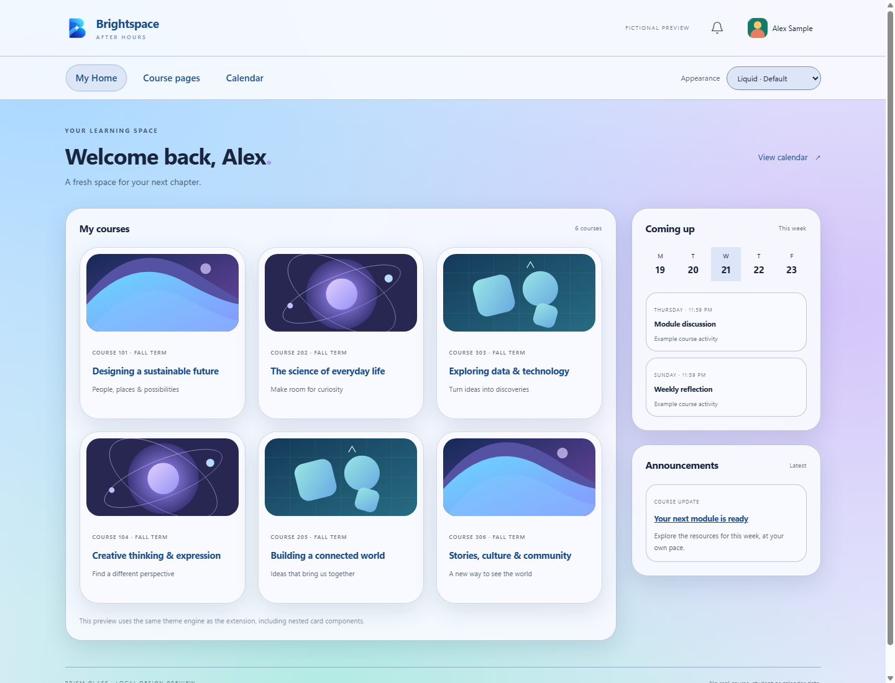
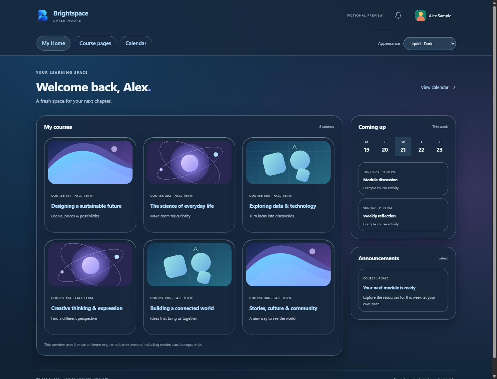

 <strong>BRIGHTSPACE AFTER HOURS</strong>

# Make Brightspace feel like your space.

A theme extension for **SNHU Brightspace**, built for Chrome and Opera. Choose a comfortable color palette or give the whole interface a fresh glass design.

I made this because I'm used to having dark mode, and Brightspace felt too bright. I wanted it to look better and feel easier to use without changing how my courses work.

**[Download v1.7.8](https://github.com/PrithviGhale/Brightspace-Theme/releases/tag/v1.7.8)** · [Report a problem](https://github.com/PrithviGhale/Brightspace-Theme/issues) · [Changelog](CHANGELOG.md)

## v1.7.8: character worlds and interface polish

Latest fixes: transparent SNHU logo backing across all themes, with a small lettering contour on dark backgrounds; centered home navigation links across all themes and a smaller, balanced Paimon icon; larger matching navigation icons in all themed modes; softly blended Genshin/Titan/Sugarbunnies/Totoro welcome art; aligned submission panels without form-table striping; and themed Add a File dialog shells/frames without white padding. Animated scenes stay outside embedded dialogs/readers. Hello Kitty and Kuromi now have illustrated welcome cards on My Home. Only character themes hide the native SNHU homepage photo; everyday palettes, animated scenes, Prism and Liquid restore it. Empty course-home headers no longer become banners or blank gaps in any theme. Miffy has bold cartoon outlines and colorful picture-book panels. Titan headings prefer installed Ditty/Cloister Black, with bundled Pirata One as a Gothic fallback. Genshin uses original Paimon, mail, chat and notices icons while preserving native navigation and unread indicators. The removed Spider-Man/Cyberpunk choices and Genshin character strip remain absent. Reload the extension and choose from the two-column **Character worlds** grid at the top of the popup.

| Theme | Design | Local preview |
| --- | --- | --- |
| Miffy | Repeating rabbit-face background on blue and picture-book panels | [Preview](docs/screenshots/miffy.png) |
| My Neighbor Totoro | Nostalgic paper, forest greens and original film stills | [Preview](docs/screenshots/totoro.png) |
| My Melody | Strawberry art, flowers, garden colors and petal-shaped panels | [Preview](docs/screenshots/my-melody.png) |
| Sugarbunnies | Twin bunny bakers, cookies, gingham and stitched biscuit-paper panels | [Preview](docs/screenshots/sugarbunnies.png) |
| Attack on Titan | Wall/Titan and Scout artwork, masonry patterns, olive and brass | [Preview](docs/screenshots/attack-on-titan.png) |
| Genshin Impact | Different artwork by page, compact tool headings, game navigation icons, Primogems and calendar Paimon | [Preview](docs/screenshots/genshin.png) |

Each has its own palette, heading font, panel shape, borders and artwork composition. Supported course pages and readings share the theme while keeping native links, controls, tables and original course/profile photos. Artwork is bundled locally; no new permissions or remote image requests. [Sources and attribution](extension/art/SOURCES.md).

Desktop/mobile rendering, palette contrast, copying/reading panels across all 22 appearances and installed Chrome extension regressions are covered by local fictional fixtures. Authenticated Brightspace and Opera still need user testing.

## Hello Kitty and Kuromi (1.6.0)

Two separate character themes are available in the two-column **Character worlds** grid at the top of the popup:

- **Hello Kitty:** pink and cream panels, a bow-pattern background, rounded cards and character stickers.
- **Kuromi:** midnight purple panels, lilac highlights, a star-pattern background and character stickers.

Both carry through supported course pages, discussions, assignments, grades, classlist, calendar, menus and embedded readings. Hover motion respects reduced-motion preferences; reading areas stay steady. Character images are bundled locally, with no remote image requests. [Artwork sources and attribution](extension/art/SOURCES.md).

Local previews use fictional data: [Hello Kitty](docs/screenshots/hello-kitty.png) | [Kuromi](docs/screenshots/kuromi.png). Version 1.6.0 includes the wider popup and copy helper below.

## New: Liquid Glass

Open **More themes → Liquid Glass**, then choose a glass appearance:

| Default | Transparent | Dark |
| :---: | :---: | :---: |
|  |  |  |
| Soft frosted panels | More of the background shines through | Deep midnight glass |

Rounded course cards, bright glass edges, pill controls, an animated pastel or midnight background, and a gentle jelly effect on hover. Reading areas stay steady. System reduced-motion settings turn off the added movement; reduced-transparency settings use solid panels where supported. This is a web interpretation inspired by liquid glass, not Apple's native rendering system.

Screenshots use **fictional local courses**, not account data. Your real course artwork, links, layout and actions stay in place. Sample calendar events and widgets in the preview are not added to your account.

## More ways to make it yours

- **Prism glass:** blue and violet glow, rounded panels, inset course images and hover lift.
- **Dark, Dim and Warm / sepia:** simple, comfortable everyday choices.
- **Ocean, Forest and Rose:** extra color palettes.
- **Midnight City, Sunset City and Aurora:** gently animated scenes.
- **Custom colors:** choose your own palette with text and focus contrast checks.
- **Original / Off:** restore Brightspace's own appearance.

The themes cover supported dashboard, discussion, announcement, assignment, feedback, grade, classlist, calendar, menu and settings surfaces. Navigation controls are compact and centered, and page titles have no solid backplate. Course photos and profile pictures stay unfiltered. Navigation branding keeps its original colors, with a light backing in dark glass designs for readability.

## Install

1. Open the **[latest release](https://github.com/PrithviGhale/Brightspace-Theme/releases/latest)** and download the versioned ZIP in **Assets**. Use the attached extension ZIP, not GitHub's “Source code” download.
2. Extract it into a permanent folder.
3. Open `chrome://extensions` or `opera://extensions` and turn on **Developer mode**.
4. Click **Load unpacked** and select the extracted folder containing `manifest.json`.
5. Pin **Brightspace After Hours**, refresh Brightspace, and choose a theme from the extension icon.

If you cloned the repository, load its **extension/** folder instead. Keep only one copy enabled. Managed school/work browsers may restrict unpacked extensions.

## Copy into documents

Version **1.6.0** has a wider 440px popup, a two-column theme picker, and **Copy selection cleanly**. Highlight text in Brightspace, open the toolbar popup, click that button, then paste normally. The focused popup writes fresh black-on-white HTML and plain text directly to the clipboard, bypassing the page's normal Copy serializers. Source text is not stored or sent to any external service.

Ctrl+C / Command+C remains supported with per-run normal colors and shadow-selection handling. A Copy helper status shows whether this version actually handled the most recent copy or could not read a selection. It records only a result, time and version locally, never copied text, source URL or names. This helps distinguish an inactive copy handler from destination formatting. Word/Opera confirmation is still pending; browser tests alone do not establish their behavior.

No clipboard-read permission or existing clipboard read is used. Password fields are excluded. Source formatting such as bold/italics is omitted; text and paragraph breaks remain. Cut, empty/image-only selections and Off retain native behavior. Destination paste options can still override incoming formatting.

## Update notices

The extension checks this repository's **public GitHub releases every six hours** while your browser is running, on browser startup when the cached check is old, and when you open the popup. **Check now** forces a fresh check.

When a newer stable version is available, a **red toolbar badge/dot** and popup notice show the version. **Get v…** opens the release page. Offline or rate-limited checks keep a previously known update notice and wait before retrying.

To install a ZIP update:

1. Download and extract the new version.
2. Replace the files in the **same folder** you originally loaded; this keeps preferences.
3. Click **Reload** on the extension's card and refresh Brightspace tabs.

ZIP installs cannot replace their own files automatically. This project has not been submitted to the Chrome Web Store or Opera Add-ons. A browser may ask you to acknowledge the new GitHub API access after upgrading from an older build.

## Privacy and access

Preferences stay in your browser profile. There are no analytics, ads, tracking, remote scripts, remote fonts, or runtime dependencies. The theme inspects element/shadow-root structure to place styles; it does **not automatically collect or save grades, assignment text, passwords, form values or discussion content**. The copy action handles only the selection you explicitly copy, without storing it.

| Access | Purpose |
| --- | --- |
| `storage` | Save appearance and public-release check results locally |
| `alarms` | Schedule a release check every six hours |
| `https://learn.snhu.edu/*` | Theme Brightspace pages and eligible HTML frames |
| `https://d1i6rhttasws5m.cloudfront.net/production/*` | Theme SNHU's embedded grade widget |
| `https://d1zg7b99iisfa6.cloudfront.net/production/*` | Theme SNHU's embedded discussion widget |
| `https://api.github.com/*` | Request only this repository's public latest-release endpoint |

The update worker sleeps between checks. Its fixed request sends no cookies, credentials, page content or referrer. GitHub receives the normal network request metadata. Only a validated stable version is saved; remote code and remote-provided links are never executed or trusted. Theme scripts make no network requests. The widget scripts run only under SNHU's top-level origin; direct visits and other embeddings are excluded.

Late-loading open components are styled through a small local lifecycle helper and observers. Original/Off disconnects theme observers and stops that helper's notifications. There is no continuous page polling.

## Coverage

Checked in isolated Chrome using the real extension and fictional page layouts: all three Liquid Glass modes, the existing themes, desktop/narrow screens, forms, supported frames, nested components, photos, reduced motion, update badges and browser restart persistence. See [verification](VERIFICATION.md) and the [page audit](PAGE_AUDIT.md).

Opera and the final installed theme on authenticated courses still need confirmation. PDFs, Office viewers, external tools, closed shadow roots and custom course templates may retain their own appearance. No assignment or quiz was submitted or attempted during testing. Calendar and notification designs restyle Brightspace's existing controls; they do not add reminder features.

## Development

No package installation is needed. See the [development guide](docs/DEVELOPMENT.md) for preview, test and package commands.

Unofficial project. Not affiliated with SNHU, D2L or Apple.