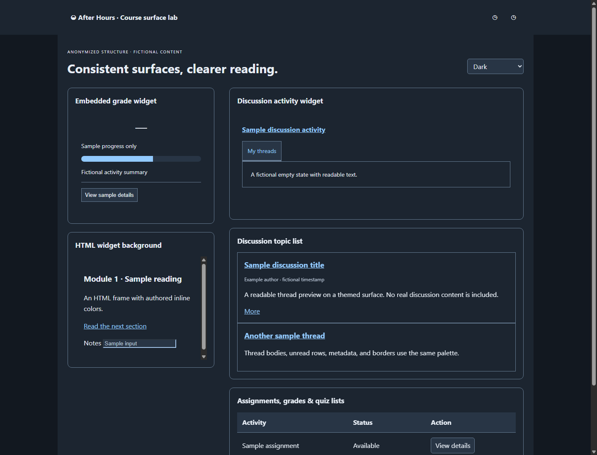
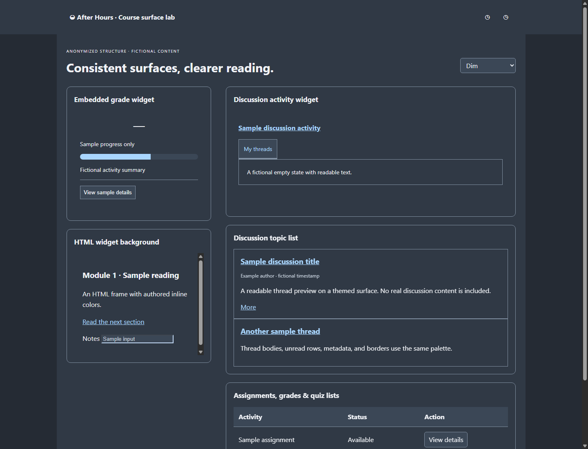
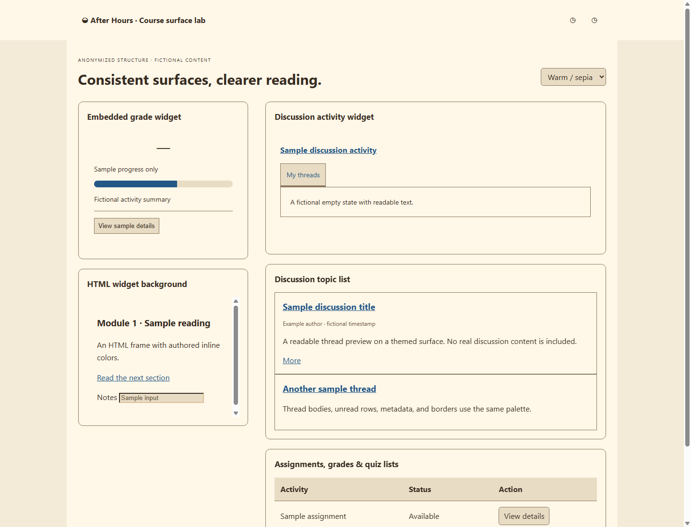
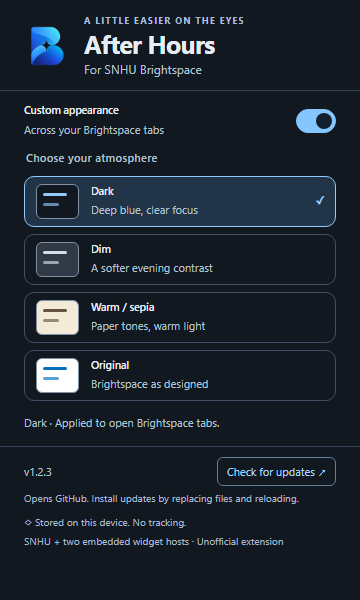

<p align="center"><br><strong>BRIGHTSPACE AFTER HOURS</strong></p>

# A calmer Brightspace, day or night.

Dark, Dim, and Warm / sepia themes for **SNHU Brightspace**, with an Original option whenever you want it. Built for Chrome and Opera.

I made this because I'm used to having dark mode, and Brightspace felt too bright. I wanted a simple way to make it more comfortable to use without changing how my courses work.

**[Download the latest release](https://github.com/PrithviGhale/Brightspace-Theme/releases/latest)** · [Report a problem](https://github.com/PrithviGhale/Brightspace-Theme/issues) · [Development guide](docs/DEVELOPMENT.md)

## Pick your atmosphere

| Dark | Dim | Warm / sepia |
| :---: | :---: | :---: |
|  |  |  |
| Deep blue surfaces | Softer evening contrast | Warm paper tones |

Screenshots show a local preview with fictional data. **Original** removes the theme styles and restores Brightspace's own appearance.

Version **1.2.1** also fixes white submission/attachment panels and patchy table cells. See the fictional [Dark](docs/screenshots/submissions-dark.png), [Dim](docs/screenshots/submissions-dim.png), and [Warm](docs/screenshots/submissions-warm.png) submission/table previews.

Version **1.2.2** protects profile photo controls and removes the added logo plate. Fictional profile previews: [Dark](docs/screenshots/profiles-dark.png), [Dim](docs/screenshots/profiles-dim.png), [Warm](docs/screenshots/profiles-warm.png).

Version **1.2.3** adds the supplied app logo and stronger protection for small reply photos and default-avatar silhouettes. The original logo source is kept in `assets/logo-original.png`; Windows developers can regenerate icon sizes with `powershell -NoProfile -File tools/build-icons.ps1`.

## What it does

- Changes the colors of Brightspace pages, menus, discussions, tables, forms, and supported widgets.
- Keeps images and videos in their original colors.
- Keeps profile photo controls transparent. The navigation logo has no added white box; Dark and Dim add a small outline around its artwork for readability. Photos stay unfiltered.
- Remembers your chosen theme on your device and updates your open Brightspace tabs.
- Includes an on/off switch and visible keyboard focus indicators.
- Adds **Check for updates**, which opens the latest GitHub release.
- Uses no analytics, tracking, runtime dependencies, or background worker.

<p align="center"></p>

## Install

1. Open the **[latest release](https://github.com/PrithviGhale/Brightspace-Theme/releases/latest)**.
2. Download **`brightspace-after-hours-1.2.3.zip`** from **Assets**. Use the extension ZIP, rather than GitHub's automatically generated “Source code” download.
3. Extract the ZIP into a permanent folder. Don't load the ZIP itself.
4. Follow the steps for your browser:

| Chrome | Opera |
| --- | --- |
| Open `chrome://extensions` | Open `opera://extensions` |
| Enable **Developer mode** | Enable **Developer mode** |
| Click **Load unpacked** | Click **Load unpacked** / **Load unpacked extension** |
| Select the extracted folder containing `manifest.json` | Select the extracted folder containing `manifest.json` |

5. Pin **Brightspace After Hours** from your browser's Extensions menu.
6. Open or refresh **https://learn.snhu.edu/**, then click the extension icon to choose a theme.

If you downloaded the whole repository, load its **`extension/`** folder instead. A school-managed browser may restrict developer-mode extensions. Opera uses the same extension files; its runtime has not yet been independently tested here.

## Update

Click **Check for updates** in the popup. It opens the latest release page only when you click it. It does not check in the background, compare versions, or install anything automatically.

For an unpacked install:

1. Download and extract the new extension ZIP.
2. Replace the files in the same folder you originally loaded. Keeping the same folder keeps your installed extension and its preferences.
3. Open `chrome://extensions` or `opera://extensions` and click **Reload** on the extension's card.
4. Refresh all Brightspace tabs and reopen the popup to check the installed version.

GitHub releases cannot automatically replace an unpacked extension's files. Browser-managed automatic updates would require distribution through a supported browser store/update channel. **This project has not been submitted to the Chrome Web Store or Opera Add-ons.**

## Privacy

The only extension API permission is **storage**. It saves two preferences: whether the theme is enabled and which theme you chose. Preferences stay in your browser profile and do not sync to an account.

The extension does **not read or save grades, assignment text, passwords, input values, discussion content, or other course data**. It looks at element/shadow-root structure to place styles. It does not transmit course data, run remote code, or make background network requests. The update link opens GitHub with no page data or referrer attached.

Website access is limited to:

| Website | Why |
| --- | --- |
| `https://learn.snhu.edu/*` | Brightspace pages and matching HTML frames |
| `https://d1i6rhttasws5m.cloudfront.net/production/*` | SNHU's embedded current-grade widget |
| `https://d1zg7b99iisfa6.cloudfront.net/production/*` | SNHU's embedded discussion-activity widget |

The two widget hosts are explicitly allowed because those widgets live outside the SNHU domain. Their theme code runs only when they are embedded under a top-level `https://learn.snhu.edu` page. Direct visits and embeddings under other websites remain unchanged. No general CloudFront access is requested. Existing widgets keep their own network behavior.

## What may still look different

- PDFs, Office viewers, other external tools, canvas graphics, and closed shadow roots may keep their original colors.
- Logos, photos, videos, and artwork may contain bright areas. They are preserved instead of inverted.
- Custom course templates, delayed components, strict page policies, and future Brightspace changes can need additional fixes.
- A brief flash of the original page can occur while preferences load. Choose Original/off before printing if you want original print colors.

Authenticated Brightspace pages were inspected for their structure and colors. Updated themes were tested on local fictional previews and in isolated Chrome extension tests. **That does not establish complete compatibility with every course or tool.** See the [page audit](PAGE_AUDIT.md) and [verification record](VERIFICATION.md) for what was checked and what remains unverified. No coursework, quizzes, or account settings were submitted or changed during inspection.

## Help improve it

If something is hard to read, switch to **Original** or turn the extension off. [Open an issue](https://github.com/PrithviGhale/Brightspace-Theme/issues) with your browser/version, theme, page type, and a cropped screenshot with personal information removed. Don't include login details, private coursework, grades, or classmates' information.

For local development, no package install is needed:

```powershell
node tools/preview-server.mjs
node tests/check.mjs
node tests/browser.mjs
node tests/extension.mjs
powershell -NoProfile -File tools/package.ps1
```

The preview opens at `http://127.0.0.1:4173/`. Browser checks use a separate test profile. See [the development guide](docs/DEVELOPMENT.md) for details.

Made by **[Prithvi Ghale](https://github.com/PrithviGhale)**. This is an independent project, not an official SNHU or D2L product.
